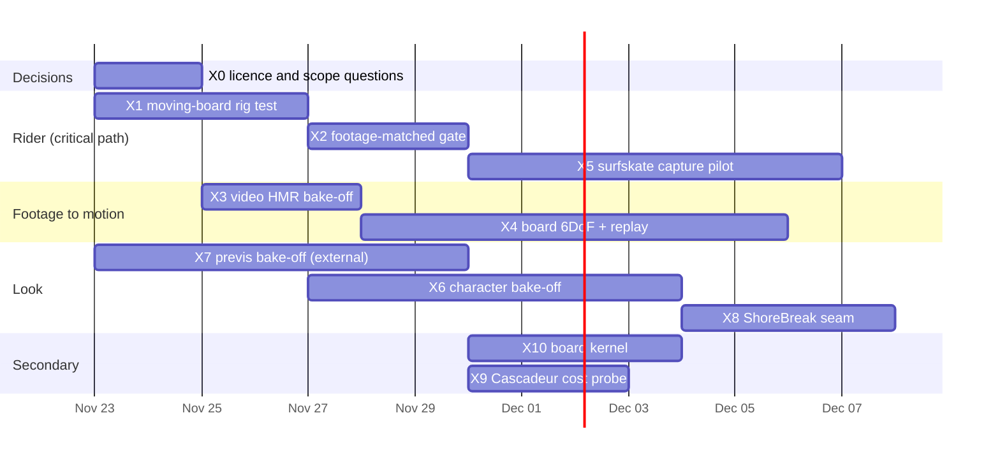

# 11 — Prioritized technical experiments

Status: v1, 2026-11-19. This consolidates the experiments proposed in documents 02–07 into
the **smallest set that resolves the major uncertainties**. IDs from the source documents are
given in brackets.

## 1. The uncertainties, ranked by risk

| # | Uncertainty | Why it matters | Resolved by |
|---|---|---|---|
| U1 | Can a procedural board-frame layer (IK + apparent-gravity balance + springs) make a surfer look **coupled to the board**, not rigidly rotating with it, and not like a passenger? | Most of the believability hinges on it, and it applies to every maneuver | X1, X2 |
| U2 | Can high-quality surfing motion be **adapted from real footage** rather than hand-authored? | It sets the animation budget, the schedule and the pipeline | X3, X4 |
| U3 | Can we **own** a capture pipeline (surfskate / land / bench) that yields believable base clips? | It is the main alternative to footage, and the source of most clips | X5 |
| U4 | Which **character source** survives a rear chase camera, extreme poses and our licence constraints? | Shirtless skin and deformation are the biggest uncanny risk; licence risk for public GLBs | X6, X0 |
| U5 | What is the **visual target**, in motion, from the rear chase camera? Which art direction? | Everything downstream is tuned against it | X7 |
| U6 | Does the surfer **integrate** with ShoreBreak's lighting, HDR and post without looking pasted in? | It is the integration seam between the two teams | X8 |
| U7 | How much does an **authored** maneuver cost (aerials, wipeouts)? | It sizes the authoring work that remains after U2/U3 | X9 |
| U8 | Is a **procedural board** as good as a professionally modelled one? | Asset pipeline choice | X10 |

## 2. Recommended experiment set

### X0 — Licence and scope questions (0.5 day + waiting) **[02 E8]**

These must be answered **before any purchase or capture spend**:

- Settled: not commercial initially, possibly later. Nothing from a non-commercial or
  territory-restricted tool goes into shipped data (README, Licensing).
- Ask Epic in writing whether MetaHuman meshes and textures may be delivered to browsers as
  glTF in a public three.js app, and what protection is required. Ask Reallusion the same
  question for CC5 (EULA §6.3).
- Settled: board world motion and the surfing sim are ours; the wave renderer supplies
  wave-state queries, and we define the lighting interface it adopts.

### X1 — Moving-board rig test (2–3 days) **[05 E1; 10 L0–L1]** — *highest priority*

A placeholder character (Mixamo or Rocketbox) on a procedural board in the Lab shell. Board
driven by scripted 6DoF (roll/pitch oscillation, 6 m carve at 8 m/s, step decelerations,
chop). Build the custom pose buffer, analytic two-bone leg IK, the pelvis apparent-gravity
solve and inertial-lag springs.

**Pass:**
- foot drift < 2 mm;
- carve lean within ±5° of `atan(v²/rg)`;
- the torso lags and recovers on deceleration in ≤ 1.5 oscillations;
- < 0.3 ms CPU per frame.

**Answers:** U1, technically. It also produces the Lab skeleton everything else uses.

### X2 — Footage-matched believability gate (3 days) **[05 E2]**

Hand-key board trajectories that roughly match 3 rear-angle pro clips (bottom turn, cutback,
trim on chop). Run X1's rider with head stabilisation and arm counterbalance, and render it
side by side with the clips. Sweep anticipation lead (0 / 0.15 / 0.3 s) and board-follow κ.

**Pass:** blind preference test with 3–5 viewers; the chosen parameters are recorded.

**Answers:** U1, visually.

### X3 — Video-to-motion bake-off (3 days, ~$10–50 GPU) **[04 E1]**

Run NVIDIA **GEM-X**, with contact post-processing on and off, and **Meta SAM 3D Body** with
smoothing, on 5 × 10 s clips:
- wave-pool rear follow;
- wave-pool side-on;
- beach telephoto side-on;
- drone high-rear;
- a top turn in spray.

Use internal-evaluation footage only (rights check), or our own clips. GEM-X and SAM 3D Body
are the only commercially licensable state-of-the-art options found.

**Pass:** ≥ 70% of frames usable after light smoothing on the two close clips.

**Answers:** U2, for the body.

### X4 — Board 6DoF + body-in-board replay (1–2 weeks) **[04 E2]**

On the best X3 clip:
1. Estimate the board pose: mask + 4–6 keypoints + PnP against a `boardkit` shortboard.
2. Convert the body to the board frame B.
3. Replay it in the Lab on a board following a *different* trajectory, with the X1
   procedural layer.

**Pass:** an animator judges it believable (no foot skate, plausible lean).

**Answers:** U2 fully. It also validates the core design decision to keep board motion and
body-in-board motion **independent but coupled**.

### X5 — Surfskate + land capture pilot (≈$0.5–3k + 1 day talent + 3–5 days cleanup) **[04 E3]**

1. Start with a **cheap pilot**: Sony mocopi (~$450) or a rented Rokoko suit, plus a phone IMU
   taped to the deck.
2. Use an intermediate-to-advanced surfer on a surfskate in a bowl.
3. Takes: pumps, frontside/backside carves, cutback, snap, good and bad pop-ups on a real
   board on a mat, bench paddling, stumbles.
4. Retarget, convert to board frame B, and play in the Lab.

**Pass:** ≥ 10 clips reach "believable" with ≤ 1 day of cleanup each.

**Answers:** U3. **Do X5 only if X1–X2 pass**: the base clips are worthless if the coupling layer fails.

### X6 — Character bake-off (≈1–1.5 weeks) **[02 E1–E5, E7]**

Candidates:
- **MetaHuman** (UE → DCC export → Blender Character DNA → GLB);
- **Character Creator 5** (FBX → GLB; requires a ~$299–499 purchase, so get approval first);
- the **open-topology spike** (MPFB2/Anny + MHR correctives).

All load in the Lab with the same skin shader. Run the pose torture test from the rear chase
camera under presets A/B/C, before and after 6 runtime correctives, dry and wet.

**Pass:**
- no candy-wrapping, knee/hip collapse or shoulder pinch at chase distance;
- wet skin reads as wet, not plastic;
- GLB ≤ 20 MB, ≤ 120 bones, 4 influences.

**Answers:** U4, and confirms the wardrobe decision (shirtless vs spring suit) for milestone 1.

### X7 — Previs bake-off (≈$200–500; external tools) **[07 exps 1, 2, 4; 09]**

1. Approve the concept reference sheets (surfer, board, three location plates) with Nano
   Banana Pro and gpt-image.
2. Run a one-shot realism bake-off (Kling 4.0, Seedance 2.5, Veo 3.1, plus two others).
3. Produce Shots 1, 2, 5 and 9 in all three art directions with the winning tool.

**Pass:** the team picks an art direction, and the chase-camera parameters (distance,
height, lag) are agreed and written into the Lab presets.

**Answers:** U5. Treat the previs as **look and camera only**, never as motion truth.

### X8 — Integration seam with ShoreBreak (≈4 days, in a ShoreBreak fork) **[06 E1, E4]**

- Ambient-consistency test: a grey sphere, a white card and a skin sphere under both
  ambient options.
- A stand-in surfer and board in ShoreBreak's opaque HDR pass, with sun shadow, PMREM and
  water-bounce fills.
- Check submerged-leg refraction, whitewater depth-test, contact light and GPU cost at 1440p.

**Pass:** the surfer doesn't look composited, and the lighting contract is agreed and
documented.

**Answers:** U6.

### X9 — Authoring cost probe (3 animator-days) **[04 E4]**

In Cascadeur, author one frontside air reverse with landing and one wipeout with a ragdoll
hand-off, against video reference.

**Pass:** each takes under 2 days and passes a blind review against real footage. This gives
the per-family authoring cost estimate.

**Answers:** U7.

### X10 — Board kernel fidelity (3–4 days) **[03 exp 1–2]**

Build `boardkit` v0 (6′0″ shortboard and 9′4″ longboard) and compare it against a real `.brd`
exported to STL and a $19 benchmark model. Checks: volume ±3%, Hausdorff distance < 3 mm,
and a blind render comparison including the backlit-foam and sanded-vs-gloss finish.

**Answers:** U8. Low risk; can run in parallel at any time.

## 3. Sequencing

Roughly **4–5 weeks** with 2 engineers, a technical artist and part-time animator help. The
critical decision point is the **end of X2 + X4** (around week 3): if both pass, the
"capture + footage + procedural layer" strategy is confirmed and X5 proceeds to full capture.

## 4. Deferred (useful, not decision-critical)

- Stream robustness under jitter [05 E3] and inertialization comparison [05 E4]: these
  become Lab L2 acceptance tests.
- Jolt wipeout round trip [05 E5]: Lab L4.
- Spray phase shading [06 E5] and wet-skin shader [02 E5]: these are part of X6/X8 polish.
- DEM horizon bake for Oʻahu [06 E2] and sky-provider prototype [06 E3]: start once the water
  team agrees the contract (X8).
- AI prop pipeline vs CC0 [07 exp 3]: low value; AI 3D is not on any critical path.
- Licence-protection reality check [02 E9]: only if Epic or Reallusion require "measures".

## 5. Spend requiring approval (none committed)

| Item | Estimate | Needed for |
|---|---|---|
| AI image + video generation credits | $200–500 (cap $750) | X7 |
| Character Creator 5 (+ content packs) | $299–499 (+$150–600) | X6 (only if MetaHuman licence or pipeline fails, or for the comparison) |
| Mocap pilot hardware or rental + surfer day | $0.5–3k | X5 |
| GPU time for video HMR | $10–50 | X3 |
| Cascadeur Indie | ~$19/month | X9 |
| Benchmark board model + `.brd` file | ~$20–60 | X10 |
